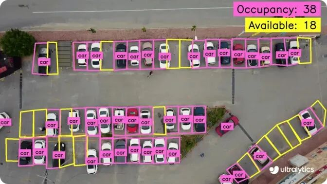
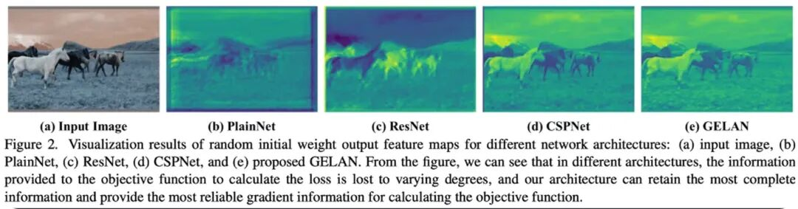
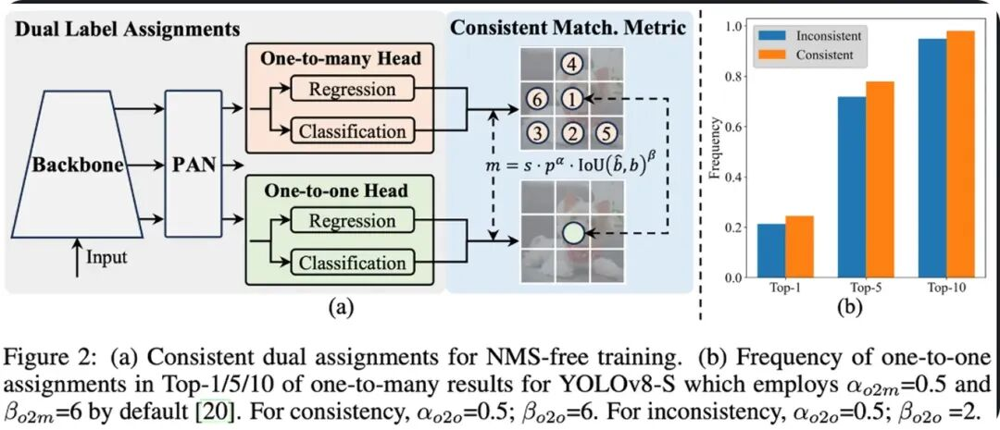
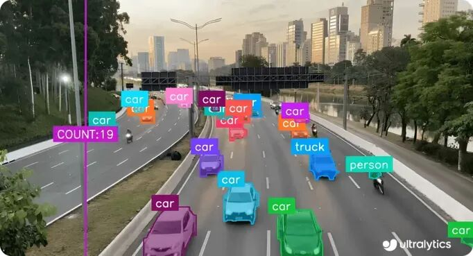
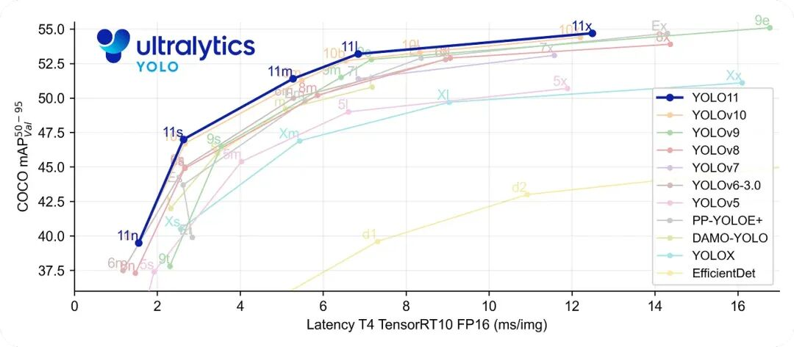
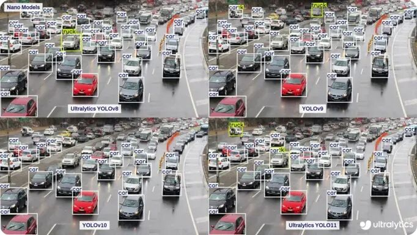

# Ultralytics YOLO11 vs Previous YOLO Models

Compare Ultralytics YOLOv8, YOLOv9, YOLOv10 and Ultralytics YOLO

Compare Ultralytics YOLOv8, YOLOv9, YOLOv10, and Ultralytics YOLO11 to understand how these models evolved and improved from 2023 to 2025.

From routine automation tasks to assisting in making timely and wise decisions, artificial intelligence (AI) is reshaping the future of various industries. Computer vision is a particularly fascinating field within AI, also known as visual AI. It focuses on enabling machines to analyze and interpret visual data like humans do.

Specifically, computer vision models are driving innovations that enhance safety and efficiency. For example, these models are used in autonomous vehicles to detect pedestrians, and in security cameras for 24/7 surveillance of locations.

Some of the most famous computer vision models are YOLO (You Only Look Once) models, which are known for their real-time object detection capabilities. Over time, YOLO models have been improved, with each new version offering better performance and increased flexibility.

Newer versions such as Ultralytics YOLO11 can handle various tasks, including instance segmentation, image classification, pose estimation, and multi-object tracking, with higher accuracy, speed, and precision than ever before.

In this article, we will compare Ultralytics YOLOv8, YOLOv9, YOLOv10 and Ultralytics YOLO11 to better understand how these models have evolved. We will analyze their main functionalities, benchmark results, and performance differences. Let's begin!

## Ultralytics YOLOv8 Overview

Ultralytics released YOLOv8 on January 10, 2023, which represents a significant advancement over earlier YOLO models. It optimizes for real-time and accurate detection, combining thoroughly tested methods with innovative updates to achieve better results.

In addition to object detection, it also supports the following computer vision tasks: instance segmentation, pose estimation, rotational bounding box (OBB) object detection, and image classification. Another important feature of YOLOv8 is its provision of five different model variants - Nano, Small, Medium, Large, and X - so you can choose an appropriate balance between speed and accuracy according to your needs.

Due to its multifunctionality and powerful performance, YOLOv8 can be used in many practical applications such as security systems, smart cities, healthcare, and industrial automation.

Figure 1. Smart City Parking Management Based on YOLOv8.

### YOLOv8 main features

Below is a detailed introduction to some other key features of YOLOv8:

- **Enhanced Detection Architecture**

YOLOv8 utilizes an improved CSPDarknet backbone network. This backbone network has been optimized for feature extraction—the process of identifying and capturing important patterns or details from the input image, which aid in making accurate predictions by the model.

- **Detector head**

It adopts an unanchored, decoupled design, meaning it does not rely on predefined bounding box shapes (anchor boxes), but instead directly learns to predict object positions. Due to the decoupled setting, the task of classifying objects and the regression task of predicting object positions are handled separately, which helps improve accuracy and speed up training.

- **Balance accuracy and speed**

The model achieves impressive accuracy while maintaining fast inference times, making it suitable for cloud and edge environments.

- **User-friendly**

YOLOv8's design makes it easy to get started - you can start predicting and see results in just a few minutes using the Ultralytics Python package.

## YOLOv9 focuses on computational efficiency

YOLOv9 was released on February 21, 2024, by Wang Jianya and Liao Hongyuan from the Institute of Information Science at the National Taiwan University. It supports tasks such as object detection and instance segmentation.

This model is built on the foundation of Ultralytics YOLOv5 and introduces two significant innovations: Programmable Gradient Information (PGI) and General Efficient Layer Aggregation Network (GELAN).

PGI assists YOLOv9 in preserving important information during data processing at each layer, thereby achieving more accurate results. Concurrently, GELAN enhances the model's usage of its layers, improving performance and computational efficiency. Thanks to these enhancements, YOLOv9 can handle real-time tasks on edge devices and mobile applications where computational resources are typically limited.

Figure 2. Understand how GELAN enhances the accuracy of YOLOv9.

### YOLOv9 main features

Below is a general overview of some other key features of YOLOv8:

- **High precision and efficiency**

YOLOv9 achieves high detection accuracy without consuming a large amount of computational power, making it an excellent choice when resources are limited.

- **Lightweight Model**

The lightweight model variant of YOLOv9 has been optimized for edge and mobile deployments.

- **Easy to use:**

Ultralytics Python package supports YOLOv9, so whether you use code or command line, it is easy to set up and run in different environments.

## YOLOv10 supports object detection without NMS.

YOLOv10 was released by researchers at Tsinghua University on May 23, 2024, focusing on real-time object detection. It addresses the limitations of earlier versions of YOLO by eliminating the need for Non-Maximum Suppression (NMS), a post-processing step used to eliminate duplicate detections and improve overall model design. This enables faster and more efficient target detection while still achieving state-of-the-art accuracy.

The key to this is a training method called Consistency Bi-Label Assignment. It combines two strategies: one that allows multiple predictions from the same object (one-to-many), and another that focuses on selecting the best single prediction (one-to-one). Since both strategies follow the same matching rules, the model learns to avoid repetition, thus eliminating the need for NMS.

Figure 3. YOLOv10 uses consistent dual-label assignment for un-NMS training.

The architecture of YOLOv10 also incorporates an improved CSPNet backbone for more effective feature learning, as well as a PAN (Path Aggregation Network) neck that combines information from different layers, making it more adept at detecting both small and large objects. These enhancements enable YOLOv10 to be applied in real-world applications such as manufacturing, retail, and autonomous driving.

### YOLOv10 main features

Below are some other prominent features of YOLOv10:

- **Large Convolutional Kernels:**

This model utilizes large convolutional kernels to capture more contextual information from a broader range of image areas, thereby aiding it in better understanding the overall scene.

- **Partial Attention Modules:**

This model incorporates a portion of self-attention modules to focus on the most important parts of the image, without consuming excessive computational power, thereby effectively enhancing performance.

- **Unique model variants:**

In addition to the common YOLOv10 sizes (Nano, Small, Medium, Large, and X), there is a special version called YOLOv10b (Balanced). It is a wider model, meaning that it processes more features per layer, which helps improve accuracy while still balancing speed and size.

- **User-friendly:**

YOLOv10 is compatible with the Ultralytics Python package and easy to use.

## Ultralytics YOLO11: Enhanced Speed and Accuracy

On September 30th this year, Ultralytics officially launched YOLO11 at the annual mixed event YOLO Vision 2024 (YV24), marking one of the latest models in the YOLO series.

This version has made significant improvements over previous versions. YOLO11 is faster, more accurate, and more efficient. It supports all computer vision tasks familiar to YOLOv8 users, including object detection, instance segmentation, and image classification. It also maintains compatibility with the YOLOv8 workflow, allowing users to easily transition to the new version.

Most importantly, YOLOv11 aims to meet a wide range of computational needs - from lightweight edge devices to powerful cloud systems. The model has open-source and enterprise versions, enabling it to adapt to different use cases.

It is a good choice for precision tasks such as medical imaging and satellite detection, as well as more widespread applications like autonomous vehicles, agriculture, and healthcare.

Figure 4. Detect, count, and track traffic using Ultralytics YOLO11.

### YOLO11 main features

Below are some other unique features of YOLO11:

- **Fast and efficient detection:**

YOLO11 features a detection head designed specifically for minimal latency, focusing on the speed of the final prediction layer without compromising performance.

- **Improved feature extraction**

Optimized backbone and neck architectures enhance feature extraction, thereby achieving more accurate predictions.

- **Cross-platform seamless deployment**

YOLO11, optimized for edge devices, cloud platforms, and NVIDIA GPUs, ensures adaptability across different environments.

## Benchmarking the YOLO model on the COCO dataset

When exploring different models, it is not always easy to compare them simply by looking at their features. That's where benchmarking comes in. By running all models on the same dataset, we can objectively measure and compare their performance. Let's take a look at how each model performs on the COCO dataset.

When comparing YOLO models, each new version has made significant improvements in terms of accuracy, speed, and flexibility. In particular, YOLOv11m has achieved a leap in this regard, as it uses fewer parameters than YOLOv8m by 22%, which means it is lighter and runs faster. Moreover, despite its smaller size, it achieves higher average precision mean (mAP) on the COCO dataset. This metric measures the extent to which the model detects and localizes targets, so higher mAP means more accurate predictions.

Figure 5. Benchmarking YOLO11 and other YOLO models on the COCO dataset.

## Test and compare YOLO models on videos

Let's explore how these models perform in real-life scenarios.

To compare YOLOv8, YOLOv9, YOLOv10 and YOLO11, all four models were run on the same traffic video with a confidence score of 0.3 (the model only displays the detection results when at least 30% is confident that the object has been correctly recognized), an image size of 640 for fair evaluation. The results of target detection and tracking highlighted key differences in detection accuracy, speed, and precision.

Starting from the first frame, YOLOv11 can identify large vehicles such as trucks that were missed by YOLOv10. YOLOv8 and YOLOv9 perform well, but vary depending on lighting conditions and object size. All models still face challenges in detecting smaller, farther vehicles, although YOLOv11 also shows significant improvements in these detections.

Figure 6. Comparison of YOLOv8, YOLOv9, YOLOv10, and YOLO11.

In terms of speed, all models operate within a frame rate of 10 to 20 milliseconds, which is fast enough to handle real-time tasks with more than 50 FPS. On the one hand, YOLOv8 and YOLOv9 provide stable and reliable detection throughout the video. Interestingly, YOLOv10, designed specifically for reducing latency, operates faster but exhibits some inconsistencies in detecting certain object types.

On the other hand, YOLO11 stands out for its precision, achieving a strong balance between speed and accuracy. Although no model performs perfectly in every frame, a side-by-side comparison clearly demonstrates that YOLO11 provides the best overall performance.

## Which YOLO model is most suitable for computer vision tasks?

The selection of the project model depends on its specific needs. For example, some applications may prioritize speed, while others may require higher accuracy or face deployment constraints that impact decision-making.

Another important factor is the type of computer vision task you need to solve. If you are looking for more general flexibility across different tasks, YOLOv8 and YOLO11 are good choices.

Choose YOLOv8 or YOLO11 actually depends on your needs. If you are a beginner in computer vision and value a larger community, more tutorials, and a wide range of third-party integrations, then YOLOv8 is a reliable choice.

On the other hand, if you are looking for superior performance, higher precision, and faster speeds, YOLO11 would be a better choice. However, since it is a relatively new version with a smaller community size and lower integration level.

## Main Points

From Ultralytics YOLOv8 to Ultralytics YOLO11, the evolution of the YOLO model series reflects a consistent pursuit for more intelligent computer vision models. Each version of YOLO has brought significant upgrades in terms of speed, accuracy, and precision.

With the continuous advancement of computer vision, these models provide reliable solutions for real-world challenges ranging from object detection to autonomous systems. The ongoing development of YOLO models demonstrates the level of progress in this field and the potential for even more achievements in the future.

## Payment

Here is a pay link on Stripe ( https://buy.stripe.com/3cs8yP7sY87d0vu9AB ). Please contact me lonlonago@foxmail.com after funding $89, and I will send you a complete data files , thank you!

